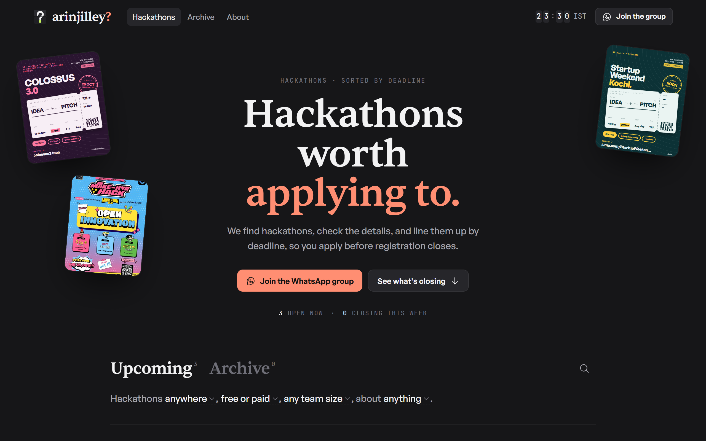
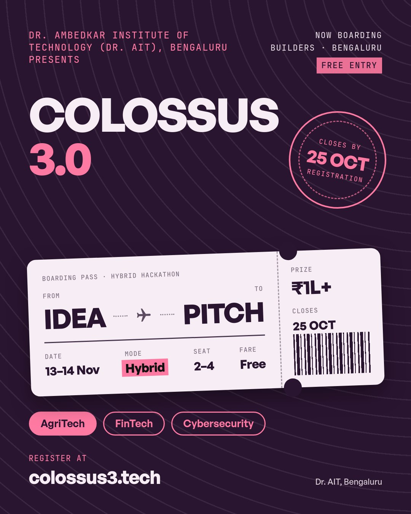
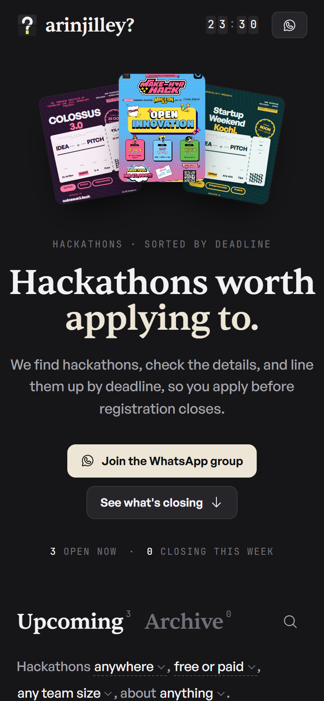
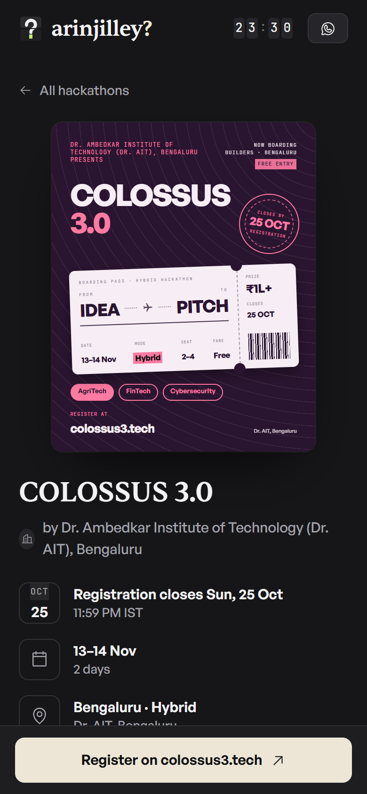
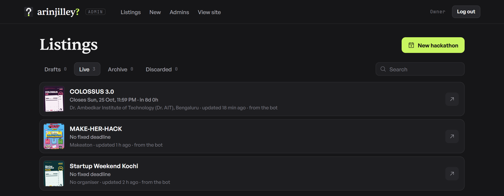

<p align="center">
  <picture>
    <source media="(prefers-color-scheme: dark)" srcset="docs/images/logo-dark.png">
    
  </picture>
</p>

<p align="center">
  <b>Hackathons worth applying to, sorted by deadline.</b><br>
  <sub><i>arinjilley?</i> is Malayalam for <i>"didn't you know?"</i></sub>
</p>

<p align="center">
  <a href="https://arinjilley.pages.dev"><b>Visit the website</b></a> ·
  <a href="https://chat.whatsapp.com/HRgBh8m962qGtkhIbVu9WH"><b>Join the WhatsApp group</b></a>
</p>

<p align="center">
  
</p>

## What is this?

**arinjilley?** is a club that shares good hackathons in a WhatsApp group. But in a busy group, posts get buried and deadlines get missed.

So every hackathon we share also goes on **[a website](https://arinjilley.pages.dev)**, lined up by when registration closes. You open it, see what's closing soon, and apply in time.

## How it works

1. **We send it to our bot.** Someone from the club forwards a hackathon post to our Telegram bot.
2. **The bot does the boring part.** It reads the post, picks out the dates, prize, team size and fee, and designs a poster. We check it and tap **Publish**.
3. **Everyone sees it.** It goes up on the website, and the bot gives us a neat message to share in the group.

## What the bot makes

<table>
<tr>
<td width="44%" valign="top"></td>
<td valign="top">

A **poster** in our boarding-pass style, made automatically for every hackathon.

And a **ready-to-paste message** for WhatsApp:

```text
🚀 *COLOSSUS 3.0*
Dr. Ambedkar Institute of Technology, Bengaluru

⏰ *Registration closes:* Sun, 25 Oct, 11:59 PM
📅 *Hackathon:* 13–14 Nov
📍 *Where:* Hybrid · Dr. AIT, Bengaluru
👥 *Team:* 2–4
🏆 *Prize pool:* ₹1 Lakh+

🔗 *Register:* https://www.colossus3.tech
🌐 *Details:* arinjilley.pages.dev/h/colossus-3-0
📲 *Join our group:* chat.whatsapp.com/…
```

</td>
</tr>
</table>

## On your phone

<table>
<tr>
<td width="50%"></td>
<td width="50%"></td>
</tr>
</table>

- **Sorted by deadline**, with a countdown, so you can see at a glance what's closing next.
- **Filters** for online or in person, free entry, solo or team, and topic.
- **Add to Google Calendar** so you get reminded before registration closes.
- **Install it like an app** on your phone. It even opens without internet.

## For the club team

Club admins get a simple dashboard to add, edit and publish hackathons from a laptop. They log in through the Telegram bot, so there are no passwords.

<p align="center">
  
</p>

## Built with

Telegram for the bot, OpenAI to read the posts, and Cloudflare to run everything, on its free plan.

**Want to run it or change it?** Everything technical (setup, deploying, how the parts fit) is in the **[developer guide](docs/DEVELOPING.md)**.

<br>

<p align="center"><sub>Made by the arinjilley? club</sub></p>
